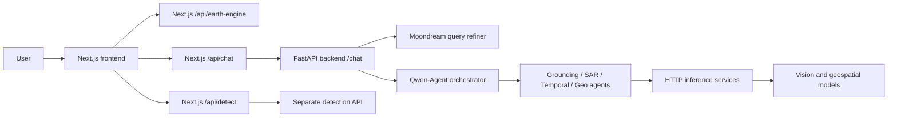

# aiml_04
# GaiaLens — Geospatial Natural Language Interface

GaiaLens is a satellite imagery analysis project with a Next.js web interface and a Python backend. Its intended workflow lets a user explore Earth imagery, upload satellite images, ask natural-language questions, and route analysis requests to vision-language models and specialist geospatial tools.

## System overview

The project brings together:

- **Image analysis UI:** upload and inspect images, zoom and pan, and use Query, Caption, or Detect modes.
- **General analysis page:** a shared image upload and chat interface for open-ended satellite image analysis.
- **Explore Earth:** ArcGIS-based map experience with region selection, Earth Engine imagery retrieval, Cesium/globe components, and a floating chat interface.
- **Python API:** FastAPI gateway at `POST /chat` that refines queries and sends them to a multi-agent orchestrator.
- **Specialist services:** separate HTTP services for grounding, segmentation, OCR, query refinement, EarthMind, temporal analysis, image enhancement, and GSD estimation.

The new frontend includes a server-side chat proxy to the Python API and a separate object-detection proxy. Some response/session details still need alignment; see [Frontend and backend integration](#frontend-and-backend-integration).

## ISRO problem statement alignment

| Problem statement capability | Related implementation |
|---|---|
| Satellite scene captioning | Vision-language model workflow in the Python backend |
| Natural-language grounding and object localization | `backend/app/intelli/grounding/` and the grounding/segmentation services |
| Semantic and geometric visual question answering | Orchestrator and `backend/app/intelli/geo_analysis/` |
| Tool-using agentic reasoning | `backend/app/intelli/orchestrator/` and its specialist agents |
| SAR and multispectral analysis | `backend/app/intelli/sar/` and the EarthMind service |
| Temporal image comparison | `backend/app/intelli/temporal/`, EarthDial, and TerraScope |
| Interactive web experience | Next.js landing page, general analysis page, and Explore Earth map |

The ISRO statement also specifies a hosted website, L1/L2 imagery in 0-255 PNG/JPG form, images up to 2k x 2k, and resilience across 0.5-10 m/pixel. The supplied source does not by itself demonstrate a public deployment, enforce all of those input constraints, or provide benchmark results for accuracy and latency. Validate these requirements with end-to-end data and measured results before claiming them as achieved.

## Architecture



The frontend chat proxy accepts multipart form data and forwards it to the Python `/chat` endpoint. Detection uses a separate API endpoint. The `/api/chat` route also forwards `session_id`, but the Python gateway currently accepts conversation history rather than a session identifier.

## Repository layout

The archives supplied are separate. A convenient working layout is:

```text
project-root/
├── backend/
│   ├── README.md
│   ├── app/
│   │   ├── app.py                    # FastAPI gateway: POST /chat
│   │   ├── query_refine.py           # Moondream client
│   │   ├── start_conv.py             # Conversation entry point
│   │   └── intelli/
│   │       ├── orchestrator/         # Main agent and tool routing
│   │       ├── grounding/            # Grounding and segmentation agent
│   │       ├── sar/                  # SAR/multispectral specialist
│   │       ├── temporal/             # Temporal comparison specialist
│   │       └── geo_analysis/         # Geospatial calculation agent
│   └── services/                     # Independently hosted model services
└── frontend/                         # Extracted `isro-vlm` Next.js project
    ├── package.json
    └── src/
        ├── app/                      # Routes and Earth Engine API route
        └── components/               # Analysis UI, map, and shared components
```

### Frontend routes

| Route | Page |
|---|---|
| `/` | Landing page |
| `/general-use` | General satellite image analysis UI |
| `/explore-earth` | ArcGIS-based Earth exploration experience |

The latest frontend archive contains only these app routes. The general analysis page offers Query, Caption, and Detect task modes, image uploads, and a workspace for viewing results. Query and Caption use `/api/chat`; Detect uses `/api/detect` and displays the returned annotated image when available.

## Quick start

### Prerequisites

- Python and pip for the backend
- Node.js and npm for the frontend
- A Qwen-compatible model endpoint and any inference services needed for the selected backend workflow
- Credentials for external map/Earth Engine features you enable
- GPU/model resources for services that require them

The backend has no root dependency manifest. The frontend includes `package-lock.json`; use `npm ci` to install its locked dependencies.

### 1. Start the backend API

Run from the directory that contains the `backend/` directory so imports such as `backend.app...` resolve:

```bash
python -m venv .venv
# Activate the virtual environment first.
pip install fastapi uvicorn python-multipart pillow requests qwen-agent
python -m uvicorn backend.app.app:app --host 0.0.0.0 --port 5000
```

This installs the visible gateway dependencies, not every specialist or model-service dependency. Each service under `backend/services/` may have its own `requirements.txt`, Dockerfile, weights, and startup procedure. Start the Qwen endpoint and the services required for the workflow separately.

Gateway API documentation: `http://localhost:5000/docs`.

### 2. Start the frontend

Run from the extracted frontend directory containing `package.json`:

```bash
npm ci
npm run dev
```

Open `http://localhost:3000`. For a production build, run:

```bash
npm run build
npm start
```

The frontend scripts also include `npm run lint`.

## Backend API

### `POST /chat`

The FastAPI gateway accepts `multipart/form-data`:

| Field | Type | Required | Description |
|---|---|---:|---|
| `query` | text | Yes | Natural-language question or instruction. |
| `history` | text | No | JSON array of turns with `role` and `content`. |
| `images` | file, repeatable | No | One or more image files. |

Example:

```bash
curl -X POST http://localhost:5000/chat \
  -F 'query=Describe the scene and locate the ships.' \
  -F 'images=@satellite-image.png'
```

The JSON response contains `response` and query-refinement fields, typically `related_to_history`, `intent`, `refined_query`, and `lora`.

The handler returns `422` for invalid history JSON or image handling errors, `502` when query refinement fails, and `500` when orchestration fails. Downstream services can return their own errors.

## Frontend and backend integration

The frontend contains a Next.js `POST /api/chat` route. It accepts multipart fields, forwards `query`, `history`, and `images` to `BACKEND_API_URL + /chat`, and returns the backend JSON. The general analysis page and Explore Earth chat use this route. Set `BACKEND_API_URL` to the Python gateway address. The frontend proxy defaults to `http://localhost:8000`, while the backend quick-start command in this README uses port `5000`; for that command, set `BACKEND_API_URL=http://localhost:5000` in the frontend's `.env.local`.

The frontend also forwards `session_id`, but the Python `POST /chat` handler currently has no `session_id` parameter or persistent session store. Conversation context is provided through `history`.

The frontend's `/api/detect` route calls a separate object-detection API configured by `DETECT_API_URL` (the source contains a hosted default). It does not call the Python gateway's grounding agent. Configure the detection endpoint deliberately for your deployment.

The frontend includes a `/files/[name]` proxy that requests `/files/{name}` from the Python backend. The supplied FastAPI application does not define that route. The API response also does not currently return an `images` array, so generated image previews/links need a backend file-serving contract before that UI feature can work end to end. Keep backend addresses and private service credentials server-side; do not expose them to browser code.

The frontend does include `POST /api/earth-engine` for imagery requests by geographic bounding box. The route supports Google Earth Engine authentication and contains a mock fallback; real imagery requires valid credentials and project configuration.

## Configuration

### Backend service URLs

The backend reads these variables directly from the process environment; it does not automatically load a `.env` file.

| Variable | Default | Purpose |
|---|---|---|
| `QWEN_URL` | `http://localhost:8000/v1` | Qwen-compatible model API |
| `QWEN_MODEL` | `Qwen/Qwen3-VL-8B-Instruct` | Model identifier passed to Qwen-Agent |
| `GROUND_URL` | `http://localhost:8001` | Grounding service |
| `SAM3_URL` | `http://localhost:8002` | Segmentation service |
| `OCR_URL` | `http://localhost:8003` | OCR service |
| `MOONDREAM_URL` | `http://localhost:8004` | Query-refinement service |
| `EARTHMIND_URL` | `http://localhost:8005` | EarthMind service |
| `TERRASCOPE_URL` | `http://localhost:8006` | TerraScope service |
| `EARTHDIAL_URL` | `http://localhost:8007` | EarthDial service |
| `ENHANCER_URL` | `http://localhost:8008` | Image-enhancement service |
| `GSD_URL` | `http://localhost:8009` | GSD service |

### Frontend map and Earth Engine settings

The frontend source references the following configuration variables:

| Variable | Used for |
|---|---|
| `NEXT_PUBLIC_CESIUM_ION_TOKEN` | Cesium Ion access in the browser |
| `NEXT_PUBLIC_GOOGLE_MAPS_API_KEY` | Google Maps 3D access in the browser |
| `BACKEND_API_URL` | Python backend base URL used by Next.js chat and file proxies; default `http://localhost:8000` |
| `DETECT_API_URL` | Separate object-detection service URL used by `/api/detect` |
| `GEE_PROJECT_ID` | Earth Engine project ID (server-side) |
| `GEE_REFRESH_TOKEN` | Earth Engine OAuth refresh token (server-side) |
| `GEE_CLIENT_ID` / `GEE_CLIENT_SECRET` | OAuth credentials (server-side) |
| `GEE_SERVICE_ACCOUNT_KEY` | Earth Engine service-account JSON (server-side) |

Create a local `.env.local` in the frontend project for local configuration. Never commit real credentials. Only values intentionally exposed to client-side JavaScript should use the `NEXT_PUBLIC_` prefix; keep Earth Engine credentials server-side.

For local development with the backend command above, the frontend `.env.local` should include:

```dotenv
BACKEND_API_URL=http://localhost:5000
```

Set `DETECT_API_URL` to the detection service you intend to use if you do not want the source's configured default.

## Service map

| Default port | Service | Backend directory |
|---:|---|---|
| 8000 | Qwen-compatible model endpoint | External model server |
| 8001 | Grounding | `backend/services/ground_service/` |
| 8002 | Segmentation/SAM3 | `backend/services/poly_service/` |
| 8003 | OCR | `backend/services/ocr_service/` |
| 8004 | Moondream query refinement | `backend/services/moondream/` |
| 8005 | EarthMind | `backend/services/earthmind/` |
| 8006 | TerraScope | `backend/services/terrascope/` |
| 8007 | EarthDial | `backend/services/earthdial/` |
| 8008 | Image enhancement | `backend/services/image_enhancer/` |
| 8009 | GSD estimation | `backend/services/gsd_service/` |

These ports are defaults used by the Python backend to construct service URLs. They do not indicate that the services are running. The supplied `services/docker-compose.yml` does not define a complete Compose deployment.

## Development and evaluation checklist

Before presenting a full end-to-end demo, verify and document:

- The frontend-to-backend adapter and its request/response contract
- Backend URL configuration (`BACKEND_API_URL`) and the session-ID/history behavior
- Image artifact serving for the frontend `/files/[name]` proxy
- Detection service configuration and how it relates to the backend grounding agent
- Captioning, grounding (including oriented-box rendering), VQA, SAR/multispectral, and temporal examples
- Supported input formats, preprocessing, dimensions, and pixel-value ranges
- Model versions, weights, licenses, and hardware requirements
- Startup and health-check instructions for each service
- Accuracy and latency across representative image sizes and GSD values
- Earth Engine credentials and behavior with and without authentication
- Reproducible deployment steps and the hosted demo URL, if deployed

The backend stores uploaded images under `backend/app/tmp`; ensure that directory is writable and define a cleanup policy. Tools that pass local image paths require shared storage when services run on separate machines.

## Troubleshooting

- **`No module named 'backend'`:** run the API command from the directory containing `backend/`, or set `PYTHONPATH` to that directory's parent.
- **Backend connection errors:** check that the required service is running and that its corresponding `*_URL` points to a reachable address.
- **Missing map/imagery:** verify the relevant Cesium, Google Maps, or Earth Engine configuration. Real Earth Engine data requires valid authentication.
- **Frontend chat cannot reach the backend:** set `BACKEND_API_URL` in the frontend environment to the Python gateway base URL. The frontend proxy defaults to port 8000; the example backend command uses port 5000.
- **Detection fails while chat works:** `/api/detect` uses `DETECT_API_URL`, a separate detection service URL.
- **Generated images do not display:** the frontend file proxy expects a Python `/files/{name}` route, which is not present in the supplied FastAPI app.
- **Uploads fail across containers:** the backend may pass local file paths to tools; mount a shared volume or change the transport to pass image bytes.
- **GPU out of memory:** run only the inference services needed for the current workflow or distribute them across GPU hosts.

## Notes and attribution

Credit third-party models, datasets, checkpoints, map services, and code according to their licenses and citation requirements. Keep private imagery, credentials, generated caches, and non-redistributable model weights out of version control.
