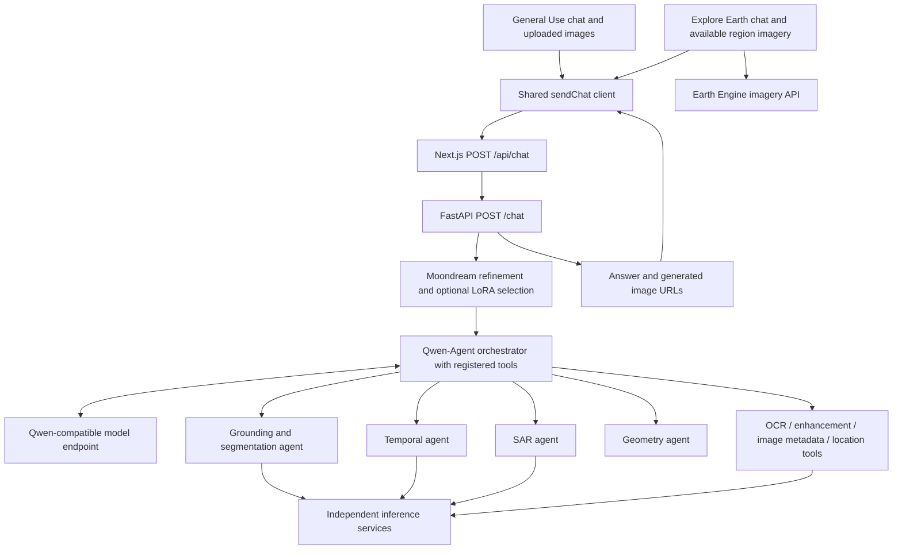
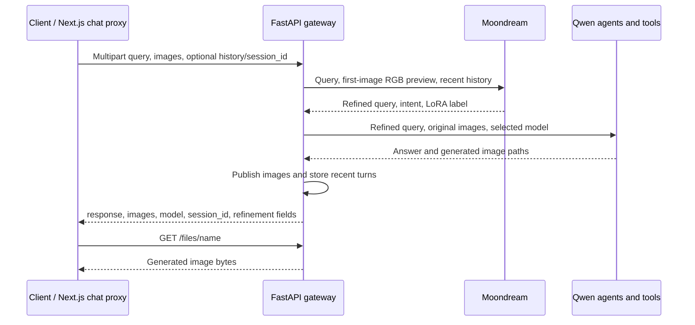

# ISRO VLM - GaiaLens

A satellite-image analysis workspace combining a **Next.js/React interface**, a **Python agent backend**, and independently hosted **vision and geospatial model services**. GaiaLens is the application name used in the UI and Python code; `isro-vlm` is the repository directory.

Users can upload imagery, ask questions, request scene descriptions, explore map regions, and compare observations. The backend combines Qwen vision-language reasoning with grounding, SAR/multispectral, temporal, OCR, enhancement, and geometry tools. Service availability and credentials determine which workflows run successfully.

## Start reading here

- [Architecture and request flows](#architecture-and-request-flows)
- [Directory and file guide](#directory-and-file-guide)
- [Model services](#model-services)
- [Local setup](#local-setup)
- [Configuration](#configuration)
- [HTTP contracts](#http-contracts)
- [Current limitations and troubleshooting](#current-limitations-and-troubleshooting)
- [Complete file inventory](docs/FILE_INDEX.md) and [consolidation record](docs/CONSOLIDATION.md)
- [Tool-to-service API map and Modal URL setup](docs/SERVICE_ENDPOINTS.md)

## Architecture and request flows

Both General Use and Explore Earth send every chat request through **`/api/chat` -> FastAPI `/chat` -> the Qwen-Agent orchestrator**. The browser does not select a model or task. The orchestrator can answer captioning and visual questions, delegate detection/segmentation to grounding, and call temporal, SAR, OCR, geometry, enhancement or context tools as needed.



### General analysis

`src/app/general-use/page.tsx` renders `components/shared/AnalysisPage.tsx`. There is a single chat composer with no Query/Caption/Detect selector. Ask naturally: "Caption this scene", "Detect the ships", or "Compare these images".

The selected workspace image is sent first, followed by other workspace images, with a new chat attachment first when present. This enables multi-image questions. A chat-only upload remains available for follow-ups. Text-only questions do not require an image. Recent conversation turns and original image files go to the shared gateway; generated image attachments are rendered in the reply.

The backend orchestrator has its specialist tool list enabled. Its tool choice is model-driven; successful inference still requires the configured Qwen, Moondream and selected specialist endpoints.

### Gateway chat



`app.py` keeps at most 20 messages per session and supplies the latest six stored messages to refinement. An explicit `history` value overrides history for that request's refinement. Session data lives in process memory and is lost on restart. It is not a shared database.

Tool output images are collected with `ContextVar` in `intelli/common.py`. The gateway copies outputs into its temporary directory and returns browser-accessible file URLs. The local runner returns only an answer string.

### Explore Earth

`components/ExploreEarth/ArcGISViewer.tsx` supplies geographic bounds and available real images in chronological order to the same chat gateway. Users can chat without selecting a region or waiting for exactly four images. Placeholder Earth Engine images marked `mock` are excluded from model inputs. The floating chat renders text and generated image attachments.

Older direct-model API routes and the local Python runner remain available for compatibility, but neither chat UI uses them.

## Directory and file guide

```text
isro-vlm/
|-- README.md                     Project guide, architecture, setup and contracts
|-- .git/                         Preserved repository history
|-- .gitignore                    Local artifacts and recovery exclusions
|-- docs/
|   |-- FILE_INDEX.md             Complete maintained-file inventory
|   `-- CONSOLIDATION.md          Merge decisions and recovery instructions
|-- frontend/
|   |-- package.json              Application dependencies and npm scripts
|   |-- package-lock.json         Locked npm dependency graph
|   |-- next.config.ts            Single Next.js configuration
|   |-- tsconfig.json             TypeScript settings and @/* source alias
|   |-- eslint.config.mjs          Next.js and TypeScript lint configuration
|   |-- postcss.config.mjs         Tailwind/PostCSS integration
|   |-- public/                   Static images and SVG assets
|   `-- src/
|       |-- app/                  Pages, layouts, styles and server routes
|       |-- components/           Page experiences and shared analysis workspace
|       |-- ui/                   Globe, parallax and testimonial visuals
|       |-- lib/utils.ts          Shared CSS class-name helper
|       `-- types/                Earth Engine and Google Maps type declarations
|-- backend/
|   |-- app/                      Gateway and model-client orchestration
|   |   |-- app.py                FastAPI /chat, /files and grounding router
|   |   |-- start_conv.py         Image normalization and shared agent entry point
|   |   |-- local_query_runner.py Legacy JSON stdin/stdout bridge
|   |   |-- query_refine.py       Moondream HTTP client
|   |   |-- requirements.txt      Gateway/agent dependencies
|   |   |-- modal_vllm/           Qwen GPU serving and LoRA instructions
|   |   |-- tmp/                  Runtime uploads/results; created as needed
|   |   `-- intelli/              Agents, tool adapters and geometry code
|   `-- services/                 Independently installed inference services
`-- local-recovery/               Local-only originals; excluded from Git
```

### Frontend source

| Path under `frontend/src/` | Responsibility |
|---|---|
| `app/page.tsx`, `components/HomePage/` | Landing page, navigation and globe visuals |
| `app/layout.tsx`, `app/globals.css` | Root layout, typography and shared styles |
| `app/general-use/page.tsx` | General image-analysis page |
| `components/shared/AnalysisPage.tsx` | Image workspace, image controls and orchestrator chat submission |
| `app/explore-earth/` | Map page and its layout |
| `components/ExploreEarth/ArcGISViewer.tsx` | Map interaction, selected region and imagery workflow |
| `components/ExploreEarth/CesiumViewer.tsx` | Cesium viewer implementation |
| `components/ExploreEarth/FloatingChatWindow.tsx` | Reusable floating chat presentation |
| `components/Agriculture/LandingPage.tsx` | Additional agriculture-oriented component; no dedicated app route |
| `app/api/*/route.ts` | Server adapters described in the HTTP contract table |
| `app/files/[name]/route.ts` | Forwards generated-image requests to FastAPI |
| `ui/3d-globe.tsx`, `ui/parallax-hero-images.tsx`, `ui/animated-testimonials.tsx` | Reusable visual effects |

### Agent backend source

| Path under `backend/app/` | Responsibility |
|---|---|
| `intelli/common.py` | Service URLs, model context, LoRA loading, image encoding/storage, tool HTTP helpers and final-answer extraction |
| `intelli/orchestrator/orch.py` | Registers specialist agents as callable tools and builds the main Qwen agent |
| `intelli/orchestrator/tools/image_analyzer.py` | Image metadata and GSD tool adapter |
| `intelli/orchestrator/tool_utils/init_image_analyze.py` | Supporting image inspection logic |
| `intelli/orchestrator/tools/image_context.py` | Retrieves location and nearby satellite context |
| `intelli/orchestrator/tools/ocr_tool.py`, `image_enhancer.py` | OCR and super-resolution adapters |
| `intelli/grounding/ground.py` | Grounding agent configuration and prompt |
| `intelli/grounding/api.py` | Direct `/ground` API, structured box parsing and rendering |
| `intelli/grounding/tools/mdetr_tool.py`, `yolo_tool.py` | Perception-service object detection and direct YOLO `/predict` annotation tool |
| `intelli/grounding/tools/open_lang_ground.py`, `draw_poly.py` | Open-language grounding and polygon segmentation |
| `intelli/grounding/tool_utils/` | Image conversion and bounding-box drawing helpers |
| `intelli/sar/sar_agent.py`, `tools/earthmind_tool.py` | SAR/multispectral agent and EarthMind adapter |
| `intelli/temporal/temporal_agent.py`, `tools/dial.py`, `tools/terra.py` | Temporal reasoning, EarthDial multi-image and TerraScope two-image tools |
| `intelli/geo_analysis/geo_analyser.py` | Agent that routes geometric calculations |
| `intelli/geo_analysis/tools/geo_tools.py`, `tool_utils/common.py` | Coordinates, polygon measures, distances, intersections and GSD-based conversions |
| `modal_vllm/vllm_server.py` | Modal deployment definition for Qwen/vLLM; not started by FastAPI |
| `modal_vllm/lora/README.md` | Adapter placement and serving instructions |

Grounding accepts one image per specialist call; temporal analysis requires at least two. Geometry consumes coordinates and scale supplied in the query. Pixel coordinates and Qwen's relative 0-1000 coordinates are distinguished by keys in `grounding/api.py`; do not treat them interchangeably.

## Model services

These directories are separate deployment units. Install their dependencies in separate environments; a gateway install does not install every GPU model. Local ports in agent configuration are client defaults, not proof that any service is running.

| Directory under `backend/services/` | Contents and role |
|---|---|
| `ground_service/Ground_service/perception_backend/` | Perception API: `app/api/` routes, `app/core/` model lifecycle/providers/image handling, `app/tools/` object detection/segmentation/image analysis, `tests/`, `deployment/modal/`, `weights/` and `packages/sac-shared-contracts/` |
| `poly_service/SAM3_endpoint/app/` | Segmentation endpoint, request schemas, configuration and model/image helpers |
| `mdetr/O2_RTDETR_endpoint/` | Detector service with an `app/` package and Modal deployment |
| `yolo_serve/yolovr/` | YOLO Modal API and `best.pt` checkpoint |
| `moondream/moondream/` | Query-refinement FastAPI app, Modal wrapper and API smoke script |
| `earthmind/api_earthmind/` | EarthMind reasoning API, requirements, deployment and smoke script |
| `earthdial/temporal_comparison_tool/` | Temporal API/client/CLI, Modal wrapper, tests and bundled `earthdial/` model, training and evaluation code |
| `terrascope/teres/` | TerraScope API and Modal wrapper |
| `ocr_service/ocr_serve/` | OCR API and dependencies; parent contains Dockerfile |
| `image_enhancer/SlimDiffSR_API/` | Super-resolution API and model service; parent contains Dockerfile |
| `gsd_service/gsd_dataset/` | GSD training, feature extraction, inference, API, checkpoint and feature cache |
| `web_searching/websearch/` | Location-context API, GeoCLIP client, context pipeline and Modal endpoint |

For endpoint-specific installation, start with each service's own README and manifest (`requirements.txt`, sometimes `app/requirement.txt`). Some older service READMEs describe historical layouts; the table and [file index](docs/FILE_INDEX.md) describe this checkout. No root Docker Compose stack is present.

## Local setup

Commands below run from **`isro-vlm/`** unless noted. Use Python 3.10+ for the gateway (the source uses modern union annotations), Node.js compatible with the locked frontend dependencies, and npm. GPU services have additional CUDA/model requirements defined by their own deployment code.

### 1. Python environment

```powershell
python -m venv .venv
.\.venv\Scripts\Activate.ps1
python -m pip install -r backend/app/requirements.txt
$env:QWEN_URL = "http://localhost:8000/v1"
# Point at your running Moondream service if using gateway chat.
$env:MOONDREAM_URL = "http://localhost:8004"
python -m uvicorn backend.app.app:app --host 127.0.0.1 --port 8080
```

On Linux/macOS activate with `source .venv/bin/activate` and set variables with `export NAME=value`. API documentation is available at `http://localhost:8080/docs` after the gateway starts. Launch the required model endpoints separately; starting the API alone does not provide model inference.

### 2. Frontend

In another terminal:

```powershell
cd frontend
npm ci
# Preserve an existing .env.local; create one only if missing.
if (-not (Test-Path .env.local)) { Copy-Item .env.example .env.local }
npm run dev
```

Open `http://localhost:3000`. Set `BACKEND_API_URL=http://localhost:8080` in frontend `.env.local`. Configure Qwen and specialist service variables in the gateway process; the browser chat no longer spawns Python from Next.js.

```powershell
npm run lint
npm run build
npm start
```

Both chat UIs need the reachable FastAPI gateway and its configured model services. Next.js runs the HTTP proxy on a Node server; this is not a static export. The legacy `/api/query-orchestrator` route still requires Python beside Next.js if called directly.

### 3. Optional model deployment

`backend/app/modal_vllm/vllm_server.py` and service `modal_app.py` files define cloud deployments. Inspect their GPU, volumes, model access and environment settings before using them. For example, with Modal installed/configured:

```powershell
modal deploy backend/app/modal_vllm/vllm_server.py
```

Set `QWEN_URL` to the returned compatible `/v1` URL. This repository cleanup does not deploy or validate hosted models.

## Configuration

The gateway reads process environment variables; it does not automatically load a root `.env`. Next.js loads frontend `.env.local`. Existing local settings were retained during consolidation.

| Frontend variable | Purpose/default |
|---|---|
| `BACKEND_API_URL` | Chat/file proxy base URL; default `http://localhost:8080` |
| `GAIALENS_PYTHON` | Python executable for the legacy local-query route; default `python` on Windows, `python3` elsewhere |
| `LOCATION_CONTEXT_API_URL` | Location lookup for the legacy local-query route; source includes a hosted Modal default |
| `EARTHMIND_API_URL` | Caption and Explore Earth model API; hosted default |
| `YOLOVR_API_URL` | Separate `/api/detect` service; hosted default |
| `TERRASCOPE_API_URL` | Separate temporal proxy; hosted default |
| `GEE_PROJECT_ID` | Google Earth Engine project |
| `GEE_REFRESH_TOKEN`, `GEE_CLIENT_ID`, `GEE_CLIENT_SECRET` | Earth Engine OAuth settings |
| `GEE_SERVICE_ACCOUNT_KEY` | Alternative Earth Engine service-account JSON |
| `NEXT_PUBLIC_CESIUM_ION_TOKEN`, `NEXT_PUBLIC_GOOGLE_MAPS_API_KEY` | Browser-visible map provider settings |

`DETECT_API_URL` appears in older documentation but the merged detector route reads `YOLOVR_API_URL`. Variables with `NEXT_PUBLIC_` are intentionally visible to the browser. Keep private service and Earth Engine credentials server-side.

| Agent variable | Default in `backend/app/intelli/common.py` |
|---|---|
| `QWEN_URL`, `QWEN_MODEL` | `http://localhost:8000/v1`, `Qwen/Qwen3-VL-8B-Instruct` |
| `GROUND_URL`, `OCR_URL`, `TERRASCOPE_URL`, `EARTHDIAL_URL`, `CONTEXT_URL` | Hosted Modal URLs retained from outer backend |
| `YOLOVR_URL` (or `YOLOVR_API_URL`) | Hosted YOLO-World service used by the grounding agent's `yolo_object_detection` tool |
| `SAM3_URL` | `http://localhost:8002` |
| `MOONDREAM_URL` | `http://localhost:8004` |
| `EARTHMIND_URL` | `http://localhost:8005` |
| `ENHANCER_URL` | `http://localhost:8008` |
| `GSD_URL` | `http://localhost:8009` |
| `LORA_GROUNDING_PATH`, `LORA_VQA_PATH`, `LORA_CAPTIONING_PATH`, `LORA_SAR_PATH`, `LORA_IR_PATH` | Optional adapter paths visible to the vLLM server; absent/failed adapters fall back to the base model |
| `TMP_MAX_AGE_HOURS` | `24`; old temporary files are cleaned during incoming gateway/grounding requests |

Frontend `EARTHMIND_API_URL` and Python `EARTHMIND_URL` configure different callers. Likewise, `LOCATION_CONTEXT_API_URL` and `CONTEXT_URL` are separate settings. Hosted defaults are configuration values, not availability guarantees.

## HTTP contracts

| Route | Input and behavior |
|---|---|
| `POST /api/query-orchestrator` | Multipart `prompt`, required `image` (up to 10 MiB), optional JSON `history`; returns `answer` and `location_context` |
| `POST /api/captions` | Multipart `prompt`, optional `image` (up to 12 MiB); forwards EarthMind `query_type: normal` and returns upstream JSON |
| `POST /api/explore-earthmind` | Multipart `prompt` (up to 8,000 chars), exactly four `images` (12 MiB each); EarthMind temporal analysis |
| `POST /api/detect` | Multipart `image`/`prompt` or JSON base64 image; calls YOLO `/predict`; returns annotated data URL, prompt and summary |
| `POST /api/terrascope` | Multipart `prompt`, required `image`, optional `compare_image` (12 MiB each); forwards upstream result |
| `POST /api/earth-engine` | JSON geographic bounds; returns imagery metadata/URLs or marked mock output |
| `POST /api/chat` | Multipart `query`, optional repeated `images`, `session_id`, JSON `history`; forwards to FastAPI |
| `GET /files/[name]` (Next.js) | Proxies the corresponding FastAPI generated-file request |
| `POST /chat` (FastAPI) | Returns `response`, `images`, refinement fields, `model`, `session_id` |
| `POST /ground` (FastAPI) | Multipart `query` and `image`; runs grounding directly and draws detected boxes |
| `GET /files/{name}` (FastAPI) | Serves a file from the gateway temporary directory after checking its resolved path |

For a direct gateway request on Windows:

```powershell
curl.exe http://localhost:8080/chat -F "query=Describe this satellite image" -F "images=@satellite.png"
```

Gateway errors include `422` for invalid JSON/image handling, `502` for refinement failure, and `500` for orchestration failure. Specialist responses can introduce additional errors. The gateway validates history as user/assistant text turns and forwards it to both refinement and orchestration.

## Current limitations and troubleshooting

- **Connection refused / inference failure:** check the URL for the actual path being used. Both chats need Qwen and Moondream; the orchestrator calls specialist services as needed. Required specialist services depend on tools chosen by the model.
- **Python import failure:** launch the gateway from `isro-vlm/` with its virtual environment activated and gateway dependencies installed. `GAIALENS_PYTHON` only affects the legacy subprocess route.
- **Detection requests:** ask in chat with an image attached. The orchestrator delegates grounding to its tools; successful detections and overlays depend on the configured services.
- **Placeholder map imagery:** inspect `mock` flags and Earth Engine authentication; placeholders must not be treated as measured observations.
- **Lost sessions:** gateway history is in memory. Multiple workers do not share it; both chat UIs send recent history explicitly.
- **Missing generated files:** outputs expire via temporary-file cleanup. The local runner does not return the gateway's structured image list.
- **Remote image paths:** local agent tools use disk paths; service adapters often convert them to base64. Any endpoint still requiring paths needs shared storage or an explicit byte transport.
- **Deployment hardening:** there is no application authentication/session database in the gateway. vLLM's configured client key is `EMPTY`; enabling server authentication requires matching client support. Review these boundaries before public deployment.
- **Model provenance:** bundled weights, caches and third-party model code remain in service directories. Review each upstream license and model requirement before redistributing them; this repository has no root license granting blanket rights.
- **Validation scope:** source structure and local compilation checks do not establish model accuracy, latency, or compliance with an ISRO evaluation. GPU inference, real credentials, image-format limits and end-to-end workflows require separate validation.

## Development guide

Start with the request route, then follow its adapter into `start_conv.py` or the service it calls. A new agent tool needs a registered name, input schema, implementation, import registration, and an entry in the relevant agent's tool list. Put service-specific model code under `backend/services/`; keep orchestration adapters under `backend/app/intelli/`.

Use the existing perception and EarthDial tests for changes to those services, in their own dependency environments. Many `test_api.py` scripts call live services and are not isolated unit tests. Generate shared perception schemas through the scripts in `packages/sac-shared-contracts/` rather than editing generated JSON by hand.

The [consolidation record](docs/CONSOLIDATION.md) explains which duplicates were removed, how conflicting versions were retained, and where to recover an original file.

### Chat regression checks

Run `python -m unittest discover -s backend/tests -v` from the project root and `node --test tests/chat.test.cjs` from `frontend/`. These tests mock inference and verify history forwarding, text-only and multiple-image requests, returned image attachments, error handling and restored specialist tool registration. They do not measure model accuracy or test live hosted endpoints.
